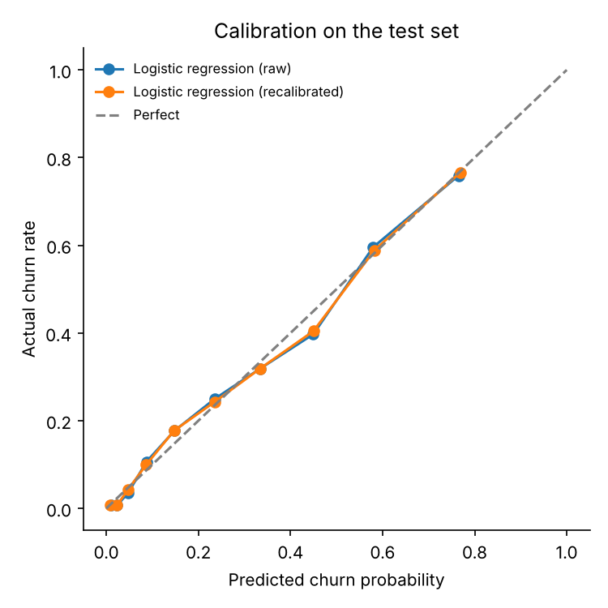
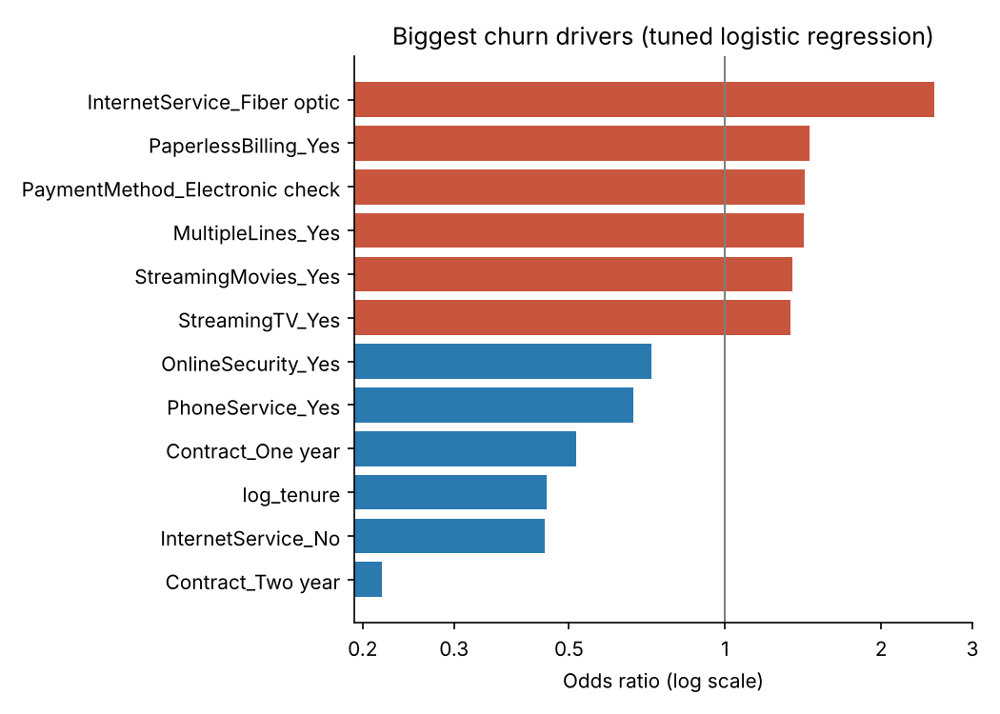
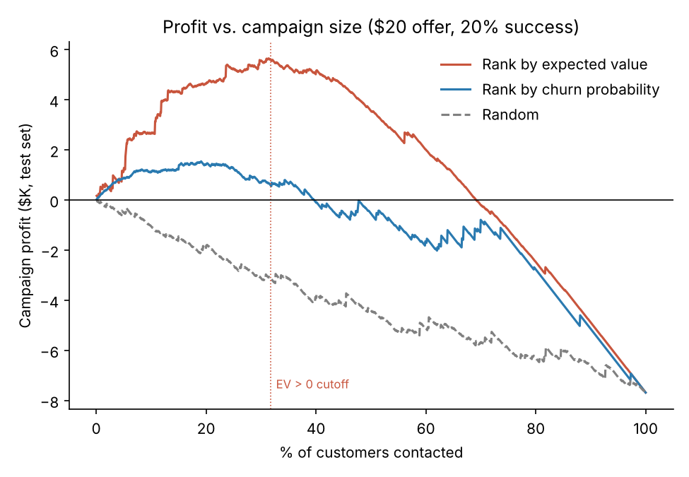

# Customer Churn Prediction: Which Customers Are Worth Saving?
### Predicting Customer Churn and Valuing Retention with the IBM Telco Dataset


**Faria T** · October 2026

---

## Abstract

Customer churn, the loss of subscribers through cancellation, directly reduces recurring revenue for subscription businesses. Most churn studies stop at predicting *who* will leave. This project asks the question a retention budget depends on: *which* customers are worth trying to save, and whether doing so is profitable. Using IBM's Telco Customer Churn dataset (7,043 customers, 26.5% churn), I compared 11 classification models selected on cross-validated log loss. A regularized logistic regression performed best (test ROC-AUC 0.849, accuracy 80.7%, well calibrated). Gradient-boosted models are statistically indistinguishable from it, and the result holds when they get larger searches and alternative features. Contract type, tenure, and fiber-optic internet are the strongest determinants of churn: a 2-year contract is associated with 78% lower churn odds, and fiber optic with 2.5 times higher odds. I then valued each customer by their expected remaining lifetime and tested a retention campaign under a decision rule fixed in advance. Ranking customers by expected value rather than churn probability raised campaign profit from about $600 to $5,600 on the test set (95% CI for the difference: $2,400 to $8,100). The ranking advantage survives changes to the valuation assumptions, though its size depends heavily on them, including an unresolved question about whether churn is measured monthly or quarterly. It does not survive every scenario: if contract customers who intend to leave rarely respond to an offer, the advantage disappears or reverses. Roughly 30% of the base-case profit rested on 7 customers. The main practical conclusion: retention offers that move customers onto contracts create far more value than one-time discounts.

---

## 1. Introduction

**Customer churn** is when a customer stops doing business with a company. For a telecom provider, it means a subscriber cancels phone or internet service. Each cancellation removes a stream of monthly revenue that can only be replaced by winning new customers, which has its own cost. The **churn rate** is the share of customers who leave in a given period. In the data used here, 26.5% of customers left within a single month. Churn modeling is usually framed as a classification problem: given what we know about a customer, predict the probability that they leave. That framing is necessary but incomplete. A retention team has a limited budget, every offer has a cost, and customers differ in how much revenue they would bring if saved. A model that ranks customers well by risk can still direct money to the wrong people. This project treats churn prediction as the first step of a decision problem. It estimates churn probabilities, identifies what drives them, assigns each customer a dollar value, and evaluates whether a retention campaign built on those estimates would make money.

---

## Table of Contents

1. [Introduction](#1-introduction)
2. [Motivation](#2-motivation)
3. [Research Questions](#3-research-questions)
4. [Related Literature](#4-related-literature)
5. [Data Description](#5-data-description)
6. [Variables](#6-variables)
7. [Methodology](#7-methodology)
8. [Results](#8-results)
9. [Robustness Checks](#9-robustness-checks)
10. [Limitations](#10-limitations)
11. [Conclusion](#11-conclusion)
12. [Future Research](#12-future-research)
13. [Replication](#13-replication)
14. [References](#14-references)

---

## 2. Motivation

Customer churn is one of the most common portfolio projects in data science, and this dataset is one of the most common ways to do it. Many public versions follow the same template: encode the variables, often oversample the minority class, train several classifiers, and report an accuracy score of around 80% with a feature-importance chart.

That template has 3 gaps that matter to a business.

1. **It optimizes the wrong target.** Accuracy rewards predicting which side of 50% a customer falls on. It ignores how confident the prediction is, and on this data a model that predicts "nobody churns" is already 73.5% accurate.
   
2. **It ignores customer value.** A customer likely to leave next month regardless, on a low bill, is worth far less to save than a long-term contract customer showing signs of risk. Ranking by risk alone treats them the same.
   
3. **It never asks whether acting on the model pays.** A retention offer has a cost and a success rate. Without them, there is no way to say how many customers to contact, or whether to run a campaign at all.

This project was built to close those gaps, using a well-known dataset on purpose. If the conclusions differ from the hundred other versions, the difference comes from the method, not the data.

*This is a personal learning project on a public sample dataset, not a forecast for any real company.*

---

## 3. Research Questions

**RQ1. Determinants.** Which customer characteristics are associated with churn, and how large are the associations once other characteristics are held constant?

**RQ2. Model choice.** Do more flexible machine learning models (gradient boosting, random forests, neural networks) predict churn better than a regularized logistic regression on this data?

**RQ3. Customer value.** How much is a retained customer worth, and how does that value differ by contract type?

**RQ4. Targeting.** Should retention offers go to the customers most likely to churn, or to those with the highest expected value of an intervention? Under what offer costs and success rates is a campaign profitable?

---

## 4. Related Literature

**Standard churn classification.** Most public work on this dataset treats churn as a pure classification task evaluated by accuracy, F1 or AUC at a fixed 0.5 cutoff. A methodological pitfall to avoid is oversampling (e.g., SMOTE) before the train/test split, which leaks test information into training and inflates reported performance.

**Profit-based evaluation.** The e-Profits metric (Manzoor et al., 2026) argues that AUC and F1 can misdirect retention decisions because they ignore customer value and intervention costs. Evaluated on profit, including on IBM Telco, the ranking of models changes. This project adopts the same principle: campaign profit, not AUC, is the final measure.

**Survival analysis and customer lifetime value.** Databricks' Telco churn solution accelerator (Morris et al., 2021) applies Kaplan-Meier, Cox proportional hazards and accelerated failure time models to this dataset and converts survival estimates into customer lifetime value. Survival methods model *when* a customer leaves, not only *whether* (see Santos, 2026, for an introduction). Because this dataset is a single cross-section without churn dates, this project uses the simplest lifetime approximation the data supports (Section 7.4) and treats a full survival model as future work.

**Model complexity.** Flexible models such as gradient boosting can capture interactions and non-linear effects that a logistic regression cannot. Whether that improves prediction depends on the data: if most of the signal is additive, a linear model captures nearly all of it. RQ2 tests which situation this dataset is in.

---

## 5. Data Description

### 5.1 Source

The data is IBM's [Telco Customer Churn](https://github.com/IBM/telco-customer-churn-on-icp4d) sample dataset (Apache 2.0 license). IBM describes it as a fictional telecom company that provided home phone and internet services to 7,043 customers in California in Q3 (IBM Samples Team, 2019). Each row is one customer. All other variables describe the customer at the time of observation.

**A note on the churn window.** The widely used documentation for this dataset defines `Churn` as leaving "within the last month" (e.g., the Mendeley Data listing), while IBM's own description refers to a quarter (Q3). This analysis follows the monthly definition. The choice doesn't affect the prediction results, but it changes the customer valuation in Section 7.4 substantially, so Section 9.3 re-runs the campaign under the quarterly reading.

### 5.2 Sample

| | |
|---|---|
| Observations | 7,043 customers |
| Variables | 21 (1 identifier, 19 characteristics, 1 outcome) |
| Churned within the last month | 1,869 (26.5%) |
| Duplicates | None |
| Missing values | 11 blank `TotalCharges`, all customers with zero tenure who have not yet been billed; set to $0 |
| Training/test split | 5,634 / 1,409, stratified on churn |

### 5.3 Summary statistics: continuous variables

| Variable | Mean | Std. dev. | Min | Median | Max |
|---|---|---|---|---|---|
| Tenure (months) | 32.4 | 24.6 | 0 | 29 | 72 |
| Monthly charges ($) | 64.76 | 30.09 | 18.25 | 70.35 | 118.75 |
| Total charges ($) | 2,279.73 | 2,266.79 | 0 | 1,394.55 | 8,684.80 |
| Senior citizen (share) | 0.16 | | | | |

Churners and non-churners differ sharply on the two main continuous variables. Churners had an average tenure of **18.0 months** against 37.6 for those who stayed, and paid **$74.44 a month** on average against $61.27.

### 5.4 Churn rates by customer group

| Group | Share of customers | Churn rate |
|---|---|---|
| **Contract:** month-to-month | 55.0% | **42.7%** |
| one year | 20.9% | 11.3% |
| two year | 24.1% | **2.8%** |

| **Internet:** fiber optic | 44.0% | **41.9%** |
| DSL | 34.4% | 19.0% |
| none | 21.7% | 7.4% |

| **Payment:** electronic check | 33.6% | **45.3%** |
| mailed check | 22.9% | 19.1% |
| bank transfer (automatic) | 21.9% | 16.7% |
| credit card (automatic) | 21.6% | 15.2% |

| **Paperless billing:** yes / no | 59.2% / 40.8% | 33.6% / 16.3% |
| **Senior citizen:** yes / no | 16.2% / 83.8% | 41.7% / 23.6% |
| **Partner:** yes / no | 48.3% / 51.7% | 19.7% / 33.0% |
| **Dependents:** yes / no | 30.0% / 70.0% | 15.5% / 31.3% |
| **Gender:** female / male | 49.5% / 50.5% | 26.9% / 26.2% |

Two patterns stand out before any modeling:

- **Commitment predicts loyalty.** Month-to-month customers churn 15 times as often as two-year contract customers. More than half of customers in their first six months churn, against fewer than 10% of those past four years.
- **Raw differences overstate some effects.** Senior citizens churn at 41.7% against 23.6%, but much of that gap disappears once contract, services, and tenure are controlled for (Section 8.2). Descriptive tables alone would mislead here.

---

## 6. Variables

### 6.1 Outcome

| Variable | Definition | Type |
|---|---|---|
| `Churn` | 1 if the customer left within the last month (see the churn-window note in 5.1), 0 otherwise | Binary |

### 6.2 Explanatory variables

| Group | Variable | Definition | Type |
|---|---|---|---|
| Demographics | `gender` | Male or female | Binary |
| | `SeniorCitizen` | 1 if aged 65 or older | Binary |
| | `Partner` | Has a spouse or partner | Binary |
| | `Dependents` | Has children or other dependents | Binary |
| Relationship | `tenure` | Months as a customer | Continuous |
| | `Contract` | Month-to-month, one year, two year | Categorical |
| Services | `PhoneService` | Has a phone line | Binary |
| | `MultipleLines` | Has more than one phone line | Binary |
| | `InternetService` | DSL, fiber optic, or none | Categorical |
| | `OnlineSecurity`, `OnlineBackup`, `DeviceProtection`, `TechSupport` | Protection and support add-ons | Binary |
| | `StreamingTV`, `StreamingMovies` | Streaming add-ons | Binary |
| Billing | `PaperlessBilling` | Bills by email instead of mail | Binary |
| | `PaymentMethod` | Electronic check, mailed check, automatic bank transfer, automatic credit card | Categorical |
| | `MonthlyCharges` | Current monthly bill ($) | Continuous |
| | `TotalCharges` | Cumulative amount billed ($), roughly tenure × monthly bill | Continuous |

### 6.3 Variable treatment

- **Categorical variables** are one-hot encoded, with one reference category dropped. "No internet service" and "No phone service" are merged into "No" for the add-on variables, since they duplicate `InternetService` and `PhoneService`.
  
- **Tenure** enters as log(1 + tenure). Churn falls steeply in the first year and slowly afterward, and the log form captures that curvature. It was the single largest improvement in model fit (Section 9.4).
  
- **`MonthlyCharges` is excluded as a predictor.** The services a customer holds explain **99.88%** of the variation in the monthly bill (R² from a linear regression on the service variables), so it is close to a linear combination of variables already in the model. Including it does not improve fit and makes the coefficients unstable. It is still used to value customers.
  
- **`TotalCharges` is excluded** because it is approximately tenure × monthly charges and duplicates both.
  
- **Continuous variables are standardized**, so their odds ratios are per one standard deviation.

---

## 7. Methodology

### 7.1 Research design

The data are split 80/20, stratified on churn, before any analysis. Every modeling choice (feature specification, hyperparameters, model selection, calibration) is made with 5-fold stratified cross-validation on the training 80%. The test set is used only to report results. No oversampling or class weighting is applied because both distort predicted probabilities, and Section 7.5 multiplies probabilities by dollar values.

### 7.2 Specification search

Candidate feature sets were compared within logistic regression on cross-validated log loss:

| Specification | CV log loss | CV ROC-AUC |
|---|---|---|
| tenure, MonthlyCharges, SeniorCitizen + categoricals | 0.4176 | 0.845 |
| + TotalCharges | 0.4167 | 0.846 |
| log(tenure) instead of tenure | 0.4100 | 0.851 |
| log(tenure) + fiber × log(tenure) | 0.4102 | 0.851 |
| **log(tenure), MonthlyCharges dropped (chosen)** | **0.4100** | **0.851** |

### 7.3 Model selection

**Candidates.** Eleven models plus a majority-class baseline: logistic regression (elastic-net penalty), decision tree, random forest, extra trees, scikit-learn gradient boosting, XGBoost, LightGBM, support vector machine (RBF kernel), k-nearest neighbors, Gaussian naive Bayes and a multilayer perceptron. Each received a 25-draw randomized hyperparameter search.

**Selection criterion: cross-validated log loss.** Log loss measures the quality of predicted probabilities, which is what the campaign analysis needs. Two alternatives were considered and rejected:

- *Accuracy* barely separates the candidates: all eleven score between 78.6% and 80.9%. It also ignores how confident a prediction is, and it is easily inflated on imbalanced data.
  
- *AIC* requires a likelihood and a well-defined parameter count. Logistic regression has both, but tree ensembles, SVMs, and nearest-neighbor models do not, so AIC cannot rank across these families. Cross-validated log loss estimates the same quantity (out-of-sample predictive likelihood) directly, for any model.

**Tie rule.** A model counts as tied with the best if its fold-by-fold log loss gap is less than two standard errors. Among tied models, the simplest is chosen.

### 7.4 Customer value

Treating the outcome as churn within one month (Section 5.1), each contract group's churn rate is treated as a monthly hazard *h*. Under a constant hazard, a customer's expected remaining lifetime is approximately 1/*h* months, capped here at 24. The value of saving a customer is their monthly bill multiplied by that expected lifetime. Hazards are estimated on the training data only.

This is the study's strongest assumption. Its consequences are tested in Section 9.3.

### 7.5 Campaign decision rule

For each customer *i*:

> **Expected value of an offer** = P(churn)ᵢ × offer success rate × value if savedᵢ − offer cost

**Every customer with a positive expected value is contacted.** This rule is fixed before looking at test outcomes, so no part of the campaign is tuned on the test set. Realized profit is then computed using actual churn outcomes, since only customers who would really have left can be saved. Base-case assumptions: an offer costs **$20** and retains **20%** of the churners who receive it. Both are placeholders, varied in Section 9.3.

As a comparison, the same number of customers is contacted in order of churn probability alone. Uncertainty is measured with 2,000 bootstrap resamples of the test set.

---

## 8. Results

### 8.1 Predictive performance (RQ2)

**Cross-validated model comparison** (training data):

| Model | CV log loss | CV ROC-AUC | CV accuracy | Tied with best? |
|---|---|---|---|---|
| **Logistic regression** | **0.4097** | **0.851** | **80.9%** | best |
| XGBoost | 0.4103 | 0.851 | 80.7% | yes |
| LightGBM | 0.4112 | 0.850 | 80.7% | yes |
| Gradient boosting (sklearn) | 0.4122 | 0.849 | 80.7% | no |
| Neural network (MLP) | 0.4139 | 0.848 | 80.6% | no |
| Random forest | 0.4159 | 0.848 | 80.4% | no |
| Extra trees | 0.4165 | 0.847 | 80.5% | no |
| SVM (RBF kernel) | 0.4170 | 0.845 | 80.2% | no |
| k-nearest neighbors | 0.4352 | 0.841 | 79.8% | no |
| Naive Bayes | 0.4449 | 0.833 | 78.9% | no |
| Decision tree | 0.4510 | 0.803 | 78.6% | no |
| Majority baseline | 9.56 | 0.500 | 73.5% | no |

Logistic regression has the lowest log loss outright. XGBoost and LightGBM are statistically tied with it, so the tie rule selects logistic regression either way. The tuned boosting models chose very shallow trees (depth 2, or 5 leaves), which suggests they were approximating a nearly additive model.

**Test-set performance** of the selected model (1,409 customers, 374 churners):

| Accuracy | Precision | Recall | F1 | ROC-AUC | Log loss | Brier | Top-10% lift |
|---|---|---|---|---|---|---|---|
| 80.7% | 0.677 | 0.521 | 0.589 | 0.849 | 0.411 | 0.134 | 2.88 |

Precision, recall, and F1 use a 0.5 cutoff for comparability with other studies; the campaign itself uses expected value, not a fixed cutoff. On the test set, the log loss gap to XGBoost is −0.0018 (95% CI −0.0055 to +0.0018), and to LightGBM −0.0007 (95% CI −0.0043 to +0.0030). Both intervals include zero, which confirms the tie.



The predicted probabilities are well calibrated: customers given a 40% churn probability churn about 40% of the time. Platt recalibration did not improve cross-validated log loss, so raw probabilities are used.

**Answer to RQ2:** no. On this data, flexible models offer no measurable gain over a regularized logistic regression.

### 8.2 Determinants of churn (RQ1)

Odds ratios from the selected logistic regression. Above 1 means higher churn odds and below 1 means lower, holding the other variables constant. Continuous variables are per one standard deviation.



| Associated with higher churn | Odds ratio | Associated with lower churn | Odds ratio |
|---|---|---|---|
| Fiber optic internet (vs DSL) | 2.53 | Two-year contract (vs month-to-month) | 0.22 |
| Paperless billing | 1.45 | No internet service (vs DSL) | 0.45 |
| Electronic check payment | 1.42 | Longer tenure (log, per s.d.) | 0.45 |
| Multiple phone lines | 1.42 | One-year contract (vs month-to-month) | 0.52 |
| Streaming movies | 1.35 | Phone service | 0.67 |
| Streaming TV | 1.34 | Online security | 0.72 |
| Senior citizen | 1.07 | Tech support | 0.77 |

The L1 penalty set the coefficients on gender, partner status, device protection, and mailed-check and credit-card payment to zero. These carry no independent signal once the other variables are known.

Three findings stand out:

- **Contract type dominates.** A two-year contract is associated with 78% lower churn odds than month-to-month, the largest effect in the model.
  
- **Fiber optic is the most actionable finding.** Fiber is the premium service, yet fiber customers have 2.5 times the churn odds of comparable DSL customers. This points to fiber pricing or service quality. The data cannot distinguish between them.
  
- **The senior-citizen gap is mostly composition.** Raw churn is 41.7% for seniors against 23.6% for others, but the conditional odds ratio is only 1.07. Most of the raw gap reflects the contracts, services, and tenure seniors tend to have, not age itself.

**Answer to RQ1:** Commitment (contract and tenure) is the main determinant of churn, followed by service type (fiber optic) and billing method (electronic check, paperless billing). Protection and support add-ons are associated with lower churn.

### 8.3 Customer value (RQ3)

| Contract | Monthly churn rate | Expected months remaining | Average bill | Value of a saved customer |
|---|---|---|---|---|
| Month-to-month | 42.7% | 2.3 | $66.49 | **$153** |
| One year | 11.1% | 9.0 | $65.50 | **$590** |
| Two year | 2.9% | 24 (capped) | $60.87 | **$1,461** |

The common rule of thumb that a saved customer is worth a year of revenue overstates the value of month-to-month customers about five times over. A month-to-month customer saved this month is likely to leave next month anyway.

**Answer to RQ3:** A retained customer's value varies almost tenfold by contract type, from about $150 for month-to-month to about $1,460 for two-year customers. An offer that moves a customer onto a contract changes their value far more than a one-time discount does.

### 8.4 Targeting and campaign profitability (RQ4)



| Ranking rule (447 contacts each) | Actual churners reached | Profit | 95% CI |
|---|---|---|---|
| **Expected value** | 201 | **$5,610** | $3,005 to $8,834 |
| Churn probability | 260 | $593 | −$222 to $1,619 |
| Random | | loses money at every campaign size | |

Difference between the two rankings: **$5,016** (95% CI $2,359 to $8,084).

Ranking by probability reaches *more* churners (260 against 201) but earns far less. It fills the list with month-to-month customers, who are the most likely to leave and the least valuable to retain. The expected-value ranking gives up some of them for a smaller number of high-value contract customers.

An important caveat: profit is computed with the same value formula used to build the expected-value ranking, which gives that ranking a structural advantage. The fair interpretation is conditional: *if the customer values are approximately right, target by value rather than by risk.* Section 9.3 tests how far the values can move before that conclusion breaks.

**Answer to RQ4:** Under the base-case assumptions, target by expected value. Contacting about a third of customers is profitable, while ranking by churn probability alone is roughly break-even. Profitability depends heavily on offer cost and success rate, and the advantage of value ranking depends on the offer working about equally well across contract types (Section 9.3).

---

## 9. Robustness Checks

### 9.1 Was the model comparison fair to complex models?

The specification in Section 7.2 was chosen using logistic regression, and every model received the same 25-draw search. Both choices could favor logistic regression: tree models don't need a log transform, and they have more hyperparameters to tune. To test this, XGBoost and LightGBM were re-tuned with 100-draw searches over wider ranges, using both the chosen features and the full raw numeric features (`robustness_check.py`).

| Model | Features | CV log loss |
|---|---|---|
| **Logistic regression** | chosen | **0.4097** |
| XGBoost | chosen | 0.4102 |
| LightGBM | chosen | 0.4106 |
| XGBoost | raw (tenure, MonthlyCharges, TotalCharges) | 0.4109 |
| LightGBM | raw | 0.4110 |

The conclusion is unchanged. Neither extra tuning nor the alternative features let the boosting models beat logistic regression.

### 9.2 Calibration

Platt scaling was evaluated with cross-validation on the training data: CV log loss was 0.4097 raw against 0.4098 recalibrated, so the raw probabilities are used.

### 9.3 Sensitivity of the campaign result

**Concentration in two-year customers.** Two-year customers account for 84 of the 447 contacts and 60% of the contact list's total value. Only 7 of those 84 actually churned, and those 7 produce about $1,700, or 30% of total profit. Two-year customers who churned also had a median tenure of about 65 months, so many were probably leaving at the end of a contract, which the constant-hazard assumption does not capture.

| Scenario | Contacts | Profit, ranked by value | Profit, ranked by probability | Value-ranking advantage |
|---|---|---|---|---|
| Base case (24-month cap) | 447 | $5,610 | $593 | $5,016 |
| 12-month lifetime cap | 401 | $3,923 | $878 | $3,044 |
| Two-year customers excluded | 363 | $3,914 | $1,113 | $2,801 |
| Churn measured over a quarter, not a month | 749 | $26,871 | $21,503 | $5,368 |

With a 12-month cap or without two-year customers, total profit falls by about 30%, but ranking by value still wins.

The churn-window question (Section 5.1) matters most. If `Churn` covers a quarter, the implied monthly churn rates are about a third as high, month-to-month customers stay about 5.9 months instead of 2.3, and one-year customers reach the 24-month cap. Every customer becomes more valuable, the campaign grows to 749 contacts, and both rankings become clearly profitable. Value ranking still earns more ($5,368), but the gap shrinks from roughly 9x to about 1.25x, because contract type no longer separates customer values as sharply.

Across these valuation scenarios, ranking by value beats ranking by probability. The size of the advantage and the dollar totals are not robust. The next test shows the ranking itself is not robust either once save rates differ by segment.

**Offer cost and success rate** (contacts and realized profit under the expected-value rule):

| Offer cost | 10% success | 20% success | 30% success |
|---|---|---|---|
| $10 | 447 contacts, $2,805 | 714 contacts, $10,612 | 854 contacts, $19,858 |
| $20 | 89 contacts, $312 | **447 contacts, $5,610** | 619 contacts, $13,302 |
| $50 | 1 contact, $45 | 41 contacts, −$747 | 142 contacts, $1,170 |

At a $50 offer and 20% success rate, the model expected 41 contacts to be profitable, and they lost $747. With expensive offers, the margin for error is thin, and a few customers flip the outcome. That is one strong case in this study for testing an offer on a small randomized group before scaling it.

**Save rates that differ by contract type.** *(Added after review feedback.)* The table above changes the success rate for everyone at once. In practice it probably differs by segment: a two-year customer who has decided to leave may not move for a $20 offer, while month-to-month customers may respond more easily. In this test the campaign still ranks customers assuming a flat 20%, because real rates are unknown before testing. Profit is then scored with segment-specific rates standing in for what would actually happen ($20 offer, 447 contacts, bootstrap CI from 1,000 resamples).

| True save rate (month-to-month / 1-yr / 2-yr) | Profit, ranked by value | Profit, ranked by probability | Value-ranking advantage | 95% CI |
|---|---|---|---|---|
| 20% / 20% / 20% (base case) | $5,610 | $593 | $5,016 | $2,430 to $7,963 |
| 25% / 15% / 5% | $3,674 | $2,790 | $883 | −$531 to $2,373 |
| 30% / 5% / 0% | $2,326 | $4,894 | **−$2,568** | −$3,344 to −$1,781 |
| 10% / 20% / 30% | $3,908 | −$3,987 | $7,895 | $4,130 to $11,948 |

This is the most important limit on the main result. Value ranking earns its advantage by prioritizing high-value contract customers. If those customers barely respond to the offer, the advantage shrinks to statistical noise (25/15/5) or reverses (30/5/0), and ranking by churn probability makes more money. If they respond better than average, the advantage grows. The data cannot distinguish these cases, because it contains no record of who received an offer. Value ranking is therefore the better rule only if save rates are roughly similar across segments, and that has to be measured with a randomized test before the ranking is trusted.

### 9.4 Specification tests and excluded variables

- **Add-on count (`n_addons`).** An early version included the number of add-ons, which is the exact sum of six variables already in the model (perfect multicollinearity). It was removed.
  
- **Monthly charges.** With `n_addons` included, the odds ratio on monthly charges was 0.82. After removing `n_addons`, it became 2.53, and fiber optic fell from 2.95 to 1.18. A sign reversal like that is a classic multicollinearity symptom. Dropping monthly charges left fit unchanged (CV log loss 0.4100 either way) and produced stable coefficients.
  
- **Tenure transformation.** Replacing tenure with log(1 + tenure) reduced CV log loss from 0.4176 to 0.4100, the largest single improvement.
  
- **Fiber × tenure interaction.** Tested to see whether fiber customers churn early and then stabilize. Fit worsened slightly (0.4102), so it was not retained.

---

## 10. Limitations

- **Cross-sectional data.** The dataset is a single snapshot with no churn dates, usage history, or contract end dates. Time-based validation and full survival models are not possible, and monthly hazards are inferred from one period.
  
- **Ambiguous churn window.** Dataset documentation conflicts on whether churn covers one month or one quarter. The quarterly reading changes customer values and the size of the targeting advantage substantially (Section 9.3).
- **Constant-hazard valuation.** Customer value assumes each contract group churns at a constant monthly rate. It ignores contract terms that prevent leaving mid-contract and likely misstates the value of contract customers. Section 9.3 bounds the impact.
  
- **Associations, not causal effects.** The odds ratios describe who churns, not what would prevent it. Moving a customer from electronic check to automatic payment will not necessarily change their churn risk.
  
- **Assumed intervention parameters.** Offer cost and success rate are placeholders. Real values require a randomized experiment.
  
- **Uniform save rate.** The campaign assumes the offer works equally well in every segment. Section 9.3 shows that if contract customers respond much less than month-to-month customers, value ranking loses its advantage. The data has no treatment records, so uplift by segment cannot be estimated here.
  
- **Structural advantage of value ranking.** Profit is evaluated with the same value formula used for ranking, so the comparison shows what happens if the values are right, not whether they are.
  
- **Sample data.** A 26.5% monthly churn rate is far above real telecom levels. Dollar figures demonstrate the method and are not forecasts.

---

## 11. Conclusion

This study set out to move churn analysis from prediction to decision.

On prediction, the main finding is that model complexity does not matter on this data. Eleven models, from naive Bayes to XGBoost, were compared on cross-validated log loss. A regularized logistic regression performed best; the top three were statistically tied, and extra tuning did not change that. The predictive ceiling comes from the information in the data, not from the algorithm.

On determinants, contract type and tenure dominate: customers who have committed stay. Fiber-optic customers churn at 2.5 times the odds of comparable DSL customers, the clearest signal for a product team. Several large raw differences, notably for senior citizens, largely disappear once other characteristics are held constant.

On decisions, the most consequential step happened after the model. Valuing customers by expected remaining lifetime shows that a saved month-to-month customer is worth about two months of revenue, not twelve. Targeting by expected value rather than churn probability earned far more in a simulated campaign, and that advantage held across every valuation scenario tested. Its size was far less robust: it fell by about 30% under conservative assumptions, shrank to about 1.25x if churn is measured quarterly, and a third of the base-case profit rested on seven customers. The ranking itself depends on one assumption the data cannot check: that the offer works about equally well across contract types. If contract customers who plan to leave rarely respond, ranking by churn probability does better.

The practical recommendations follow directly:

1. **Target retention offers by expected value, not churn risk alone**, once a test confirms the offer works in high-value segments.
2. **Favor offers that convert customers to contracts** over one-time discounts, because contract status changes customer value nearly tenfold.
3. **Investigate fiber-optic churn** as a product or pricing issue.
4. **Test any offer on a randomized group before scaling it, and measure the save rate by segment**, since both the campaign's profitability and the choice of ranking depend on it.

---

## 12. Future Research

- **Uplift modeling.** Predict which customers are *persuadable* by an offer, rather than which are likely to leave. Some at-risk customers leave regardless, and some would stay anyway and only take the discount; contacting either wastes budget. Section 9.3 shows why this matters: segment differences in response can reverse the ranking result. Uplift models need data from a randomized offer, which this dataset does not have.
- **Survival analysis with panel data.** With churn dates and contract end dates, customer value could come from Kaplan-Meier or Cox models with tenure-dependent hazards instead of a constant monthly rate.
- **Experimental design.** A randomized test of a retention offer, with the sample size needed to detect a 20% success rate.
- **Production pipeline.** A dbt and SQL implementation of the feature pipeline, so scoring runs on a warehouse table.

---

## 13. Replication

```bash
pip install -r requirements.txt
jupyter notebook churn_model.ipynb      # full analysis, about 10-15 minutes on a 2-core machine
python robustness_check.py              # Section 9.1, a few minutes
```

Package versions are pinned, and random seeds are fixed, so results match this document.

```
telco_raw.csv          IBM Telco Customer Churn sample data
churn_model.ipynb      cleaning, specification search, 11-model comparison, calibration,
                       determinants, customer value, campaign, sensitivity
robustness_check.py    extended boosting search (Section 9.1)
calibration.png, drivers.png, profit_curve.png    charts (written by the notebook)
requirements.txt       pinned package versions
LICENSE-DATA-APACHE-2.0.txt   Apache 2.0 license covering the IBM dataset
```

---

## 14. References

- Manzoor, A., Qureshi, M. A., Kidney, E., & Longo, L. (2026). e-profits: A business-aligned evaluation metric for profit-sensitive customer churn prediction. *International Journal of Data Science and Analytics*, 22(1), Article 75. https://doi.org/10.1007/s41060-026-01044-6
- Morris, D., Leano, H., & Sobel, S. (2021, February 24). *Solution Accelerator: Telco Customer Churn Predictor.* Databricks Blog. https://databricks.com/blog/2021/02/24/solution-accelerator-telco-customer-churn-predictor.html
- Santos, G. (2026, April 9). *A Survival Analysis Guide with Python: Using Time-To-Event Models to Forecast Customer Lifetime.* Towards Data Science. https://towardsdatascience.com/a-survival-analysis-guide-with-python-using-time-to-event-models-to-forecast-customer-lifetime/
- IBM. *telco-customer-churn-on-icp4d* (code pattern and dataset; Apache License 2.0). GitHub. https://github.com/IBM/telco-customer-churn-on-icp4d
- IBM Samples Team. (2019, July 11). *Telco customer churn* (dataset description). IBM Community. https://community.ibm.com/community/user/blogs/steven-macko/2019/07/11/telco-customer-churn-1113
- *Telco customer churn IBM dataset.* Mendeley Data. https://data.mendeley.com/datasets/phsxg9ssrf

---

**Author:** Faria T
Data Analyst | Business Analytics | Economics
GitHub: https://github.com/fariat14

© 2026 Faria T. All rights reserved for the analysis, code, and writing in this repository, except as noted below. They are provided for portfolio and educational viewing. Please do not reuse them commercially without written permission, and provide attribution if you reference this work. (GitHub's Terms of Service still allow others to view and fork public repositories.)

**Third-party data:** `telco_raw.csv` is IBM's Telco Customer Churn sample dataset, redistributed unmodified from [IBM/telco-customer-churn-on-icp4d](https://github.com/IBM/telco-customer-churn-on-icp4d) under the Apache License 2.0. A copy of that license is included as `LICENSE-DATA-APACHE-2.0.txt`. The reservation of rights above does not apply to this file.
